<p align="center">
  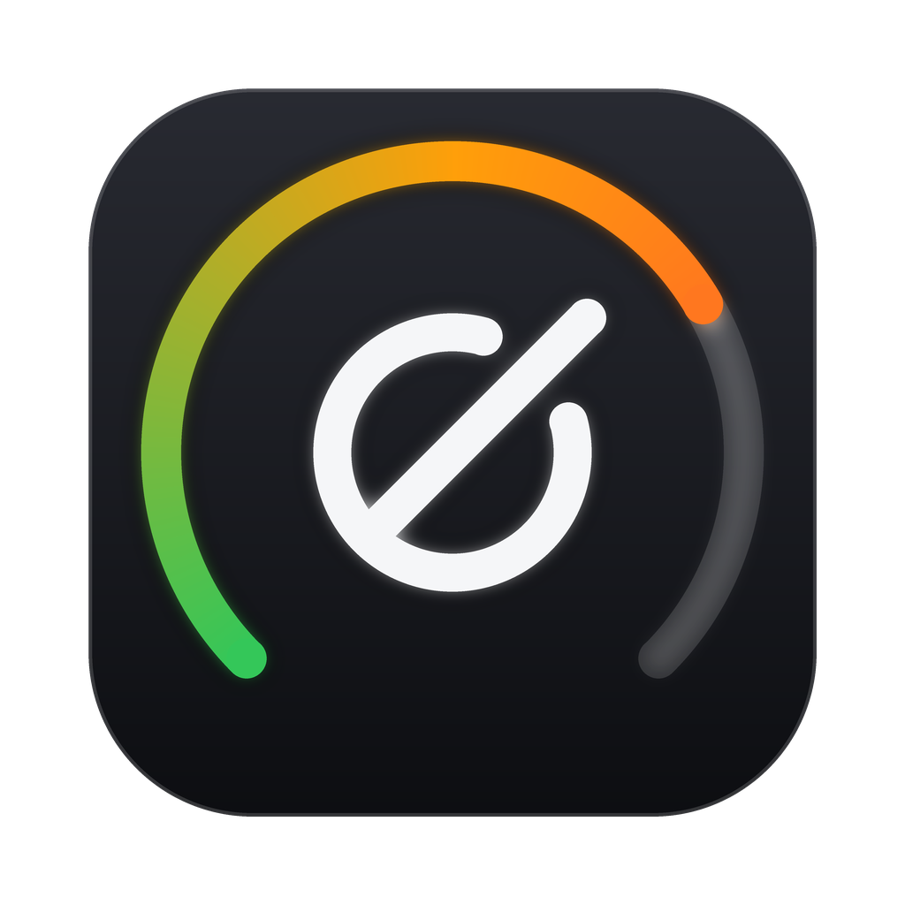
</p>

<h1 align="center">GrokGauge</h1>

<p align="center">
  Your SuperGrok and Grok Bot usage, at a glance, in the macOS menu bar.<br>
  <sub>Native Swift · macOS 14+ · Apple silicon &amp; Intel · MIT licensed</sub>
</p>

<p align="center">
  <a href="https://stevencombs.github.io/GrokGauge/"></a>
  <a href="https://paypal.me/stevencombs"></a>
  <a href="https://www.youtube.com/@retroCombs-Tech"></a>
</p>

<p align="center">
  
</p>

<p align="center"><b>🌐 <a href="https://stevencombs.github.io/GrokGauge/">Visit the GrokGauge page →</a></b></p>

## Quick install (Homebrew)

```sh
brew install --cask stevencombs/tap/grokgauge
```

This also installs the **Grok CLI** (Homebrew's [`grok-build`](https://formulae.brew.sh/cask/grok-build) cask,
downloaded from x.ai) if you don't have it yet. Then sign in once:

```sh
grok login
```

Already installed? Update to the latest version:

```sh
brew update && brew upgrade --cask grokgauge
```

This installs **GrokGauge.app** into `/Applications`. Remove it with `brew uninstall --cask grokgauge`
(add `--zap` to also delete its preferences; the Grok CLI stays installed, remove it with
`brew uninstall --cask grok-build`). No Homebrew? See [Manual](#manual) install and the
[Grok CLI](#requirements) requirements.

GrokGauge is ad-hoc signed, not notarized by Apple. So that macOS doesn't block the first launch,
the cask ([stevencombs/homebrew-tap](https://github.com/stevencombs/homebrew-tap)) removes the
download quarantine flag from `GrokGauge.app`, and only that app, right after installing it.

> **Unofficial.** GrokGauge is a community project by [retroCombs](https://www.retrocombs.com).
> It is not made, endorsed, or supported by xAI, or by Anysphere, the maker of the Grok Bot app.
> "Grok" and "SuperGrok" are trademarks of xAI. GrokGauge reads undocumented data sources that
> can change without notice.

> **New in 0.9.6:** a **Total** ring for your whole SuperGrok weekly pool plus a separate **Grok** ring for
> regular Grok use, so Grok, Grok Bot and Cursor each show their **share of pool** and add up to the Total
> (for example 14% + 27% + 1% = 42%). The days left in the menu bar (`42% · 2d`) is easier to read.
> See [CHANGELOG.md](CHANGELOG.md).

## What it does

GrokGauge tracks your weekly limits side by side:

- **Total.** SuperGrok plans share **one usage pool** across Chat, Imagine, Voice, Build, the API, Grok Bot
  and Cursor. The **Total** ring shows that whole pool. It resets **every 7 days** on your account's own schedule.
- **Grok.** Your regular Grok use (grok.com, the Grok apps, Imagine, Voice, the API): the Total minus
  Grok Bot's and Cursor's shares, captioned "share of pool".
- **Grok Bot.** If you use the [Grok Bot](https://cursor.com/bot) desktop app, its **weekly usage**
  (the number on Grok Bot's *Settings › Usage & Billing* screen) has its own limit and its own reset time.
  When Grok Bot's reading instead describes your shared SuperGrok pool (same reset minute, about the same
  percent as the Total), GrokGauge notices and the Grok Bot ring shows **Grok Bot's share of that pool**, labeled
  "share of pool", so you don't see the same number twice. If the two separate again, the ring goes back
  to Grok Bot's own allowance on its own.

Grok, Grok Bot and the optional Cursor ring are each one's slice of the pool, so together they add up to the
Total: with the sample data in the screenshots, Grok 14% + Grok Bot 27% + Cursor 1% = Total 42%.

Features:

- **Menu bar meter.** A small Grok-style glyph plus a percent, color-coded **green** up to 80%,
  **orange** from 81–90%, and **red** above 90% (levels and colors are yours to change). Show the
  **higher** of the two numbers, **both** (`G 42% · B 27%`: G is the Total, B is Grok Bot), just one source, or only the logo tinted
  by status. Optionally add the days to reset (`10% · 5d`) or hide the logo.
- **Ring gauges** for Total, Grok and Grok Bot: side by side, stacked, or one combined ring showing the higher.
  An optional fourth **Cursor ring** (off by default) shows Cursor's share of the pool when xAI's
  usage reply lists it; it needs no Cursor sign-in. With three or four rings side by side, keep the rings their
  usual size (the dropdown gets a little wider) or shrink them to fit the usual width.
- **7-day history.** A 7-day graph for each source: one bar per day with the highest % reached that day
  (or a line or area graph, your pick). With a sync folder, the graphs combine readings
  from all your Macs.
- **Reset times.** Days until reset, a live countdown, and the exact reset day and time in your
  time zone. When Grok and Grok Bot reset at different times you get one clearly labeled line for each.
  If you're on pace to run out before the reset, a warning appears right under the countdown:
  "At this pace: 100% by Fri, Oct 30" (with roughly when, e.g. "in 1 day, 8 hr · about 3 PM EDT").
  The projection uses the last day and a half of history, not the average since Monday, and when one
  product is most of that climb the line says so ("mostly Grok Bot").
- **Service status.** Two dots under the rings, one for [xAI](https://status.x.ai) and one for
  [Cursor](https://status.cursor.com) (the home of Grok Bot and Cloud Agents): green "All systems normal",
  orange for degraded, partial outage or maintenance, red for an outage, gray when the check failed. The text
  names what's affected (`xAI: Degraded: Imagine`, `Cursor: Outage: Cloud Agents`), the tooltip has the
  details and the last check time, and clicking a row opens that status page. Checked about every 5 minutes
  and when you open the dropdown. Optional notification (off by default) when a service goes from normal to
  an outage.
- **Per-product breakdown** of the pool: Chat, Imagine, Voice, Build, and API.
- **Extra Usage Credits.** Your prepaid Grok credit balance (and on-demand spend, if you've enabled it).
- **Heads-up notifications** when Grok or Grok Bot enters the warning and critical levels, once per week for each.
- **Refresh now**, last-updated time, automatic refresh every 5–60 minutes, and smart retries
  (backoff on errors, a quiet grace period after wake or a network change).
- **Global shortcut** (default **⌃⌥G**) to open the dropdown from anywhere.
- **What's new from xAI.** The newest few items from xAI's news posts, the API release notes, Grok CLI
  updates, the Grok and Grok Bot iPhone apps, and the Grok Bot app on your Mac, with an unread dot and
  **Mark all read**. When a newer Grok CLI is out it shows the update command with a **Copy** button
  (`brew upgrade --cask grok-build` for Homebrew's copy, `grok update` for the installer's; GrokGauge never runs it). Links to [@xai](https://x.com/xai) and [@grok](https://x.com/grok) on X.
  Optional notifications (off by default): one summary per check.
- **Open Grok**, **Open Grok Bot** (if installed) and **Open X** (the X app if installed, otherwise x.com) buttons.
- **Settings window** (gear button or **⌘,**): reorder and hide dropdown sections, menu bar style,
  levels and colors (with a colorblind-friendly preset), notification levels, refresh interval,
  launch at login, settings sync between Macs, diagnostics, and an optional update check.
- **Welcome tour** *(new in 0.9.5)*. An 8-step tour the first time GrokGauge opens on a Mac,
  replayable from the gear menu's **Show Welcome Tour…**. See [Welcome tour](#welcome-tour).
- **Accessible.** VoiceOver labels and values on the rings, bars, charts and buttons; respects
  Reduce Motion and Increase Contrast.

<p align="center">
  
  &nbsp;&nbsp;
  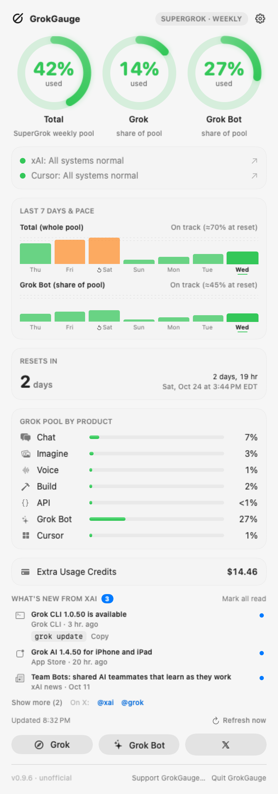
</p>
<p align="center"><sub>Screenshots use sample data (Total 42% = Grok 14% + Grok Bot 27% + Cursor 1%).</sub></p>

<p align="center">
  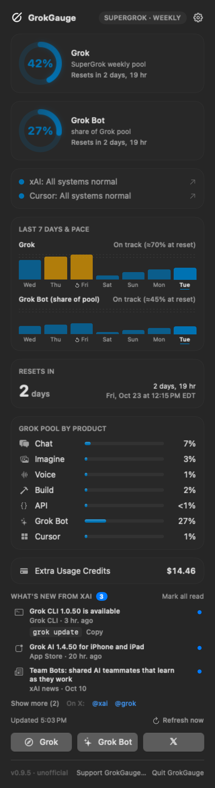
  &nbsp;
  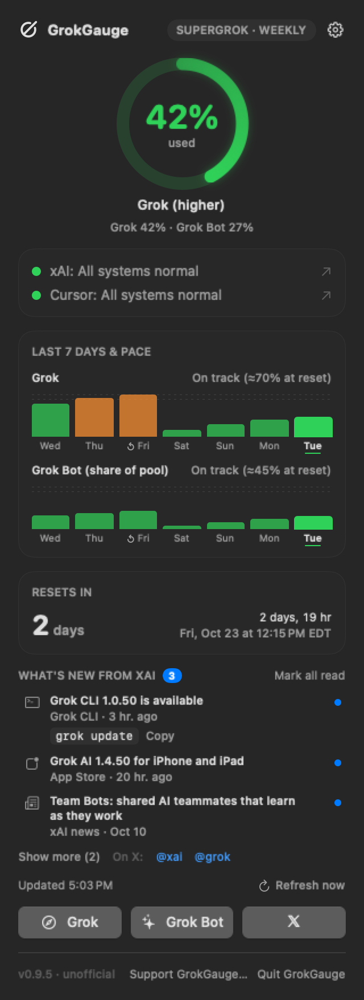
  &nbsp;
  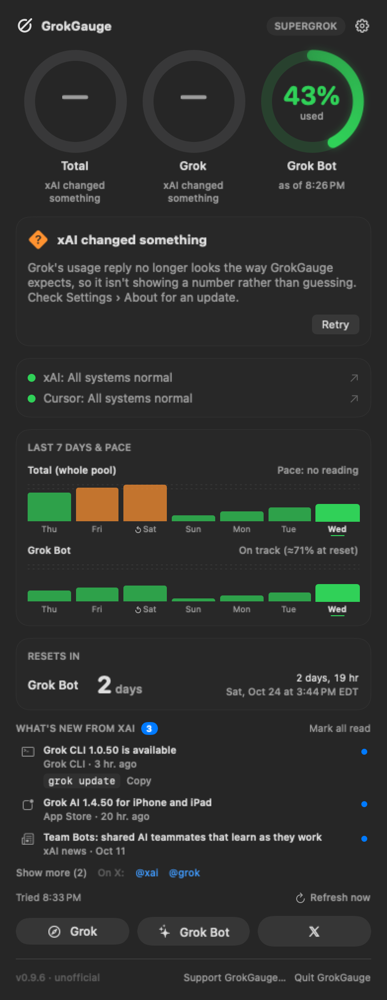
</p>
<p align="center"><sub>Stacked rings with the colorblind-friendly palette · one combined ring with sections hidden · what you see if xAI changes the usage reply.</sub></p>

<p align="center">
  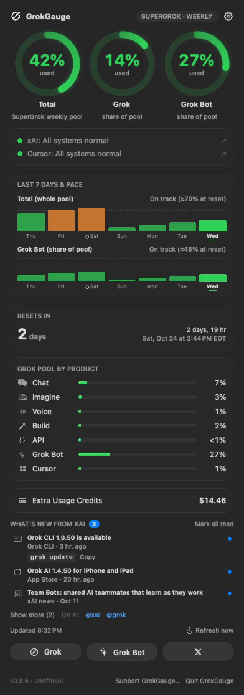
  &nbsp;
  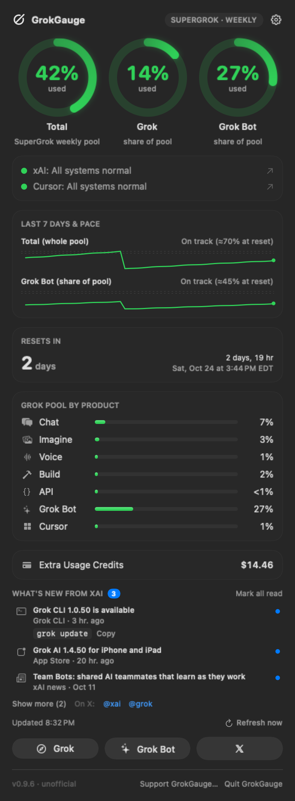
  &nbsp;
  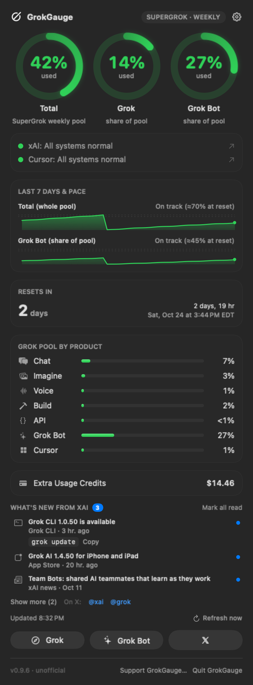
</p>
<p align="center"><sub>Graph styles: Bars (default; ↺ marks the day the week reset) · Line · Area.</sub></p>

<p align="center">
  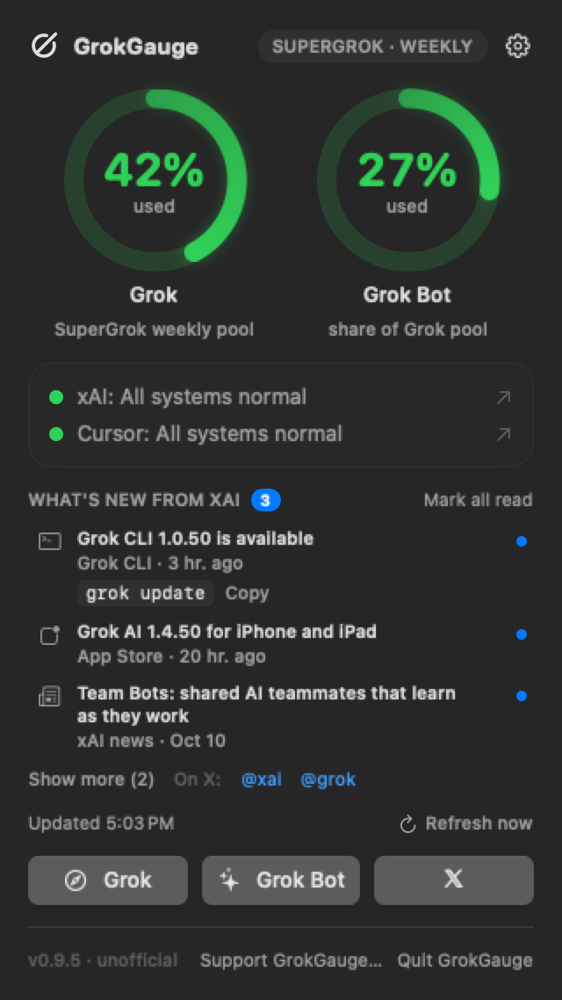
</p>
<p align="center"><sub>“What's new from xAI” (sample items).</sub></p>

<p align="center">
  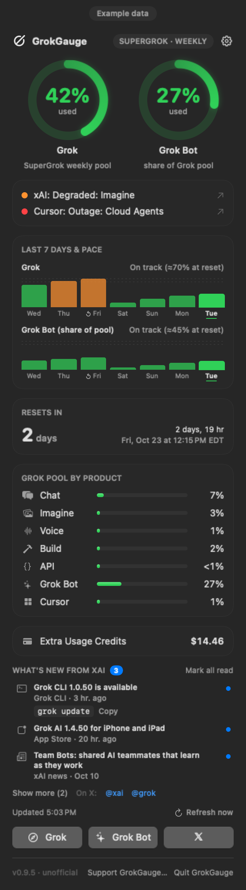
</p>
<p align="center"><sub>The service status row during an incident (example data; normally both dots are green).</sub></p>

<p align="center">
  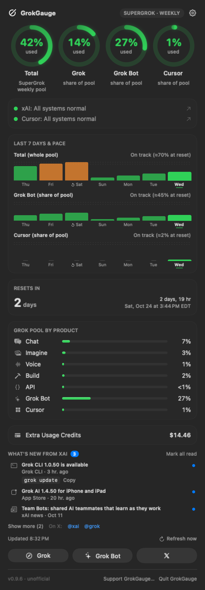
  &nbsp;
  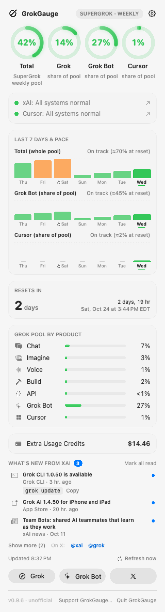
</p>
<p align="center"><sub>Four rings with the optional Cursor ring on (sample data): "Keep ring size" · "Shrink rings to fit".</sub></p>

## Requirements

- macOS 14 Sonoma or later
- A SuperGrok subscription
- The **Grok CLI** (Grok Build), signed in once. It's needed for the **Total** and **Grok** rings; the
  **Grok Bot** ring works without it. The [Homebrew install](#quick-install-homebrew) installs it for you
  (as the `grok-build` cask). Then sign in:

  ```sh
  grok login
  ```

  If Terminal says `grok: command not found`, open a new Terminal window.

  *Alternative (or no Homebrew):* xAI's official installer puts the CLI in `~/.grok/bin`:

  ```sh
  curl -fsSL https://x.ai/cli/install.sh | bash
  ```

  If `grok` isn't found right after that, open a new Terminal window or run `~/.grok/bin/grok login`.
  Having both copies is harmless: they share the same login in `~/.grok`. GrokGauge finds the CLI in
  `~/.grok/bin`, `/opt/homebrew/bin` or `/usr/local/bin` (and your shell's PATH).

  *Note:* Homebrew's unrelated `grok` **formula** (a regex tool, `brew install grok`) also installs a
  command named `grok`. If you have it, the Grok CLI cask still installs but can't take the `grok` name;
  run `brew uninstall grok` and then `brew reinstall --cask grok-build`. GrokGauge ignores the regex tool.

  GrokGauge walks you through this too: until the CLI is installed and signed in, the dropdown shows
  **Grok CLI not installed** (with **Copy install command**, **Install in Terminal…** and **Open Terminal**)
  or **Sign in to Grok** (with **Copy “grok login”**). **Install in Terminal…** asks first, then opens
  Terminal running `brew install --cask grok-build` (or, without Homebrew, xAI's installer above);
  GrokGauge never installs anything or signs in on its own. It
  notices the new login within a few seconds and switches to your usage, no relaunch needed.
  Settings › Diagnostics shows the same Grok CLI status, plus how it was installed and its version.

  GrokGauge uses the login the CLI saves in `~/.grok/auth.json` and **renews it automatically**
  the same way the CLI does, so you stay signed in without running `grok login` again. You only
  need to sign in again if xAI revokes the login (for example after a password change or
  "sign out everywhere"); the menu then shows **"Run `grok login` to reconnect."**
- *Optional:* the **Grok Bot** desktop app, signed in. GrokGauge shows the Grok Bot ring only
  when Grok Bot is installed.

## Install

### Homebrew

The [quick install](#quick-install-homebrew) at the top of this page is the recommended way.

### Manual

1. Download `GrokGauge-<version>.zip` from the [latest release](https://github.com/stevencombs/GrokGauge/releases/latest).
2. Unzip it and drag **GrokGauge.app** into `/Applications` (or `~/Applications`).
3. Open it. Look for the gauge in your menu bar.

GrokGauge releases are ad-hoc signed, not notarized by Apple, so the first time you open a
manually downloaded copy, macOS says it can't verify the app. Either:

- open **System Settings › Privacy & Security**, scroll down, and click **Open Anyway** next to
  GrokGauge (recent macOS versions no longer offer a right-click **Open** bypass), or
- remove the quarantine flag in Terminal:

  ```sh
  xattr -dr com.apple.quarantine /Applications/GrokGauge.app
  ```

Each release lists the zip's SHA-256 so you can check your download with `shasum -a 256`.

### First run

*New in 0.9.5:* GrokGauge opens a short **welcome tour** the first time it runs on each Mac.
It walks you through the steps below. See [Welcome tour](#welcome-tour).

1. Click the gauge in the menu bar (or press **⌃⌥G**) to open the dropdown.
2. When macOS asks, **allow notifications** so you get the warning and critical alerts.
3. Click the **gear** (or press **⌘,**) and turn on **Launch at login** under *Colors & Alerts*
   if you want GrokGauge to start with your Mac.
4. Use **Refresh now** any time; otherwise it updates itself every 15 minutes (adjustable).

## Welcome tour

*New in 0.9.5.* The first time GrokGauge opens on a Mac, a small window walks
you through it in 8 short cards:

1. **Welcome.** What GrokGauge is, and that it's unofficial and not affiliated with xAI.
2. **Connect.** Checks for the Grok CLI sign-in on this Mac and shows a green check, or the install and
   `grok login` steps with copy buttons and **Check Again**.
3. **The rings.** What each ring means (Total, Grok, Grok Bot and the optional Cursor ring), with *your* color levels (for example 0–80%, 81–90%, above 90%)
   and when your pool resets.
4. **The shared pool.** How Grok, Grok Bot and Cursor each show their share of the pool and add up to the Total.
5. **In your menu bar.** What the menu bar number shows (a live example in your current style) and where
   to change it.
6. **Settings & sync.** Colors & Alerts, Layout (including the optional Cursor ring) and the one-folder Sync.
7. **History & pace.** The 7-day graphs and the "on pace to run out" warning under Resets in.
8. **Enjoying GrokGauge?** An optional tip card: **🙏 Tip on PayPal** opens
   [paypal.me/stevencombs](https://paypal.me/stevencombs), **Maybe later** just closes the tour. No nagging:
   it never asks again.

Every card has **Back**, **Next** and **Skip**, with step dots. Press **Return** for the next card or
**Esc** to skip. It follows light and dark mode and works with VoiceOver. It shows once per Mac (a local
flag that isn't synced). Replay it anytime from the gear menu: **Show Welcome Tour…**.

| | |
|---|---|
| 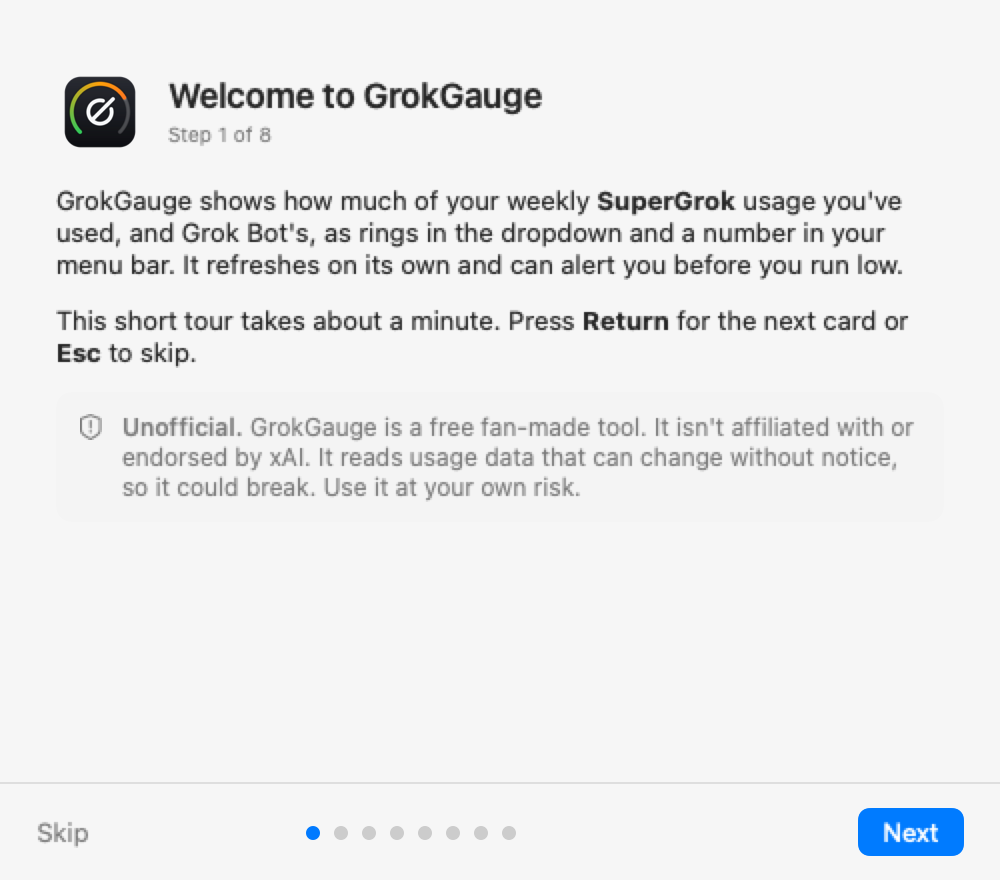 | 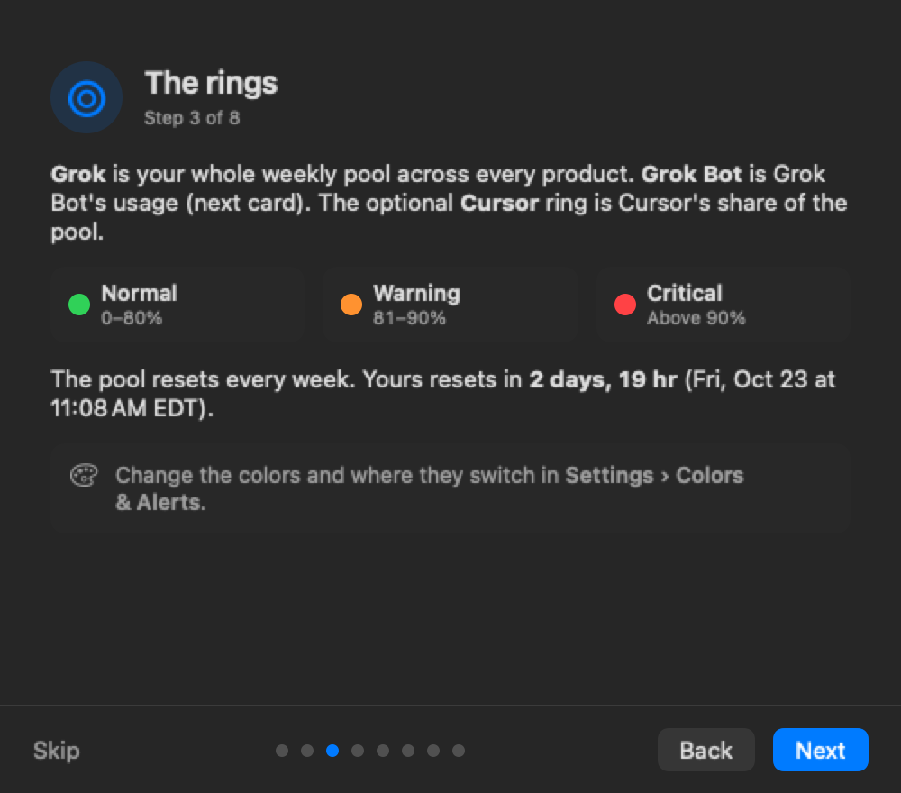 |
| 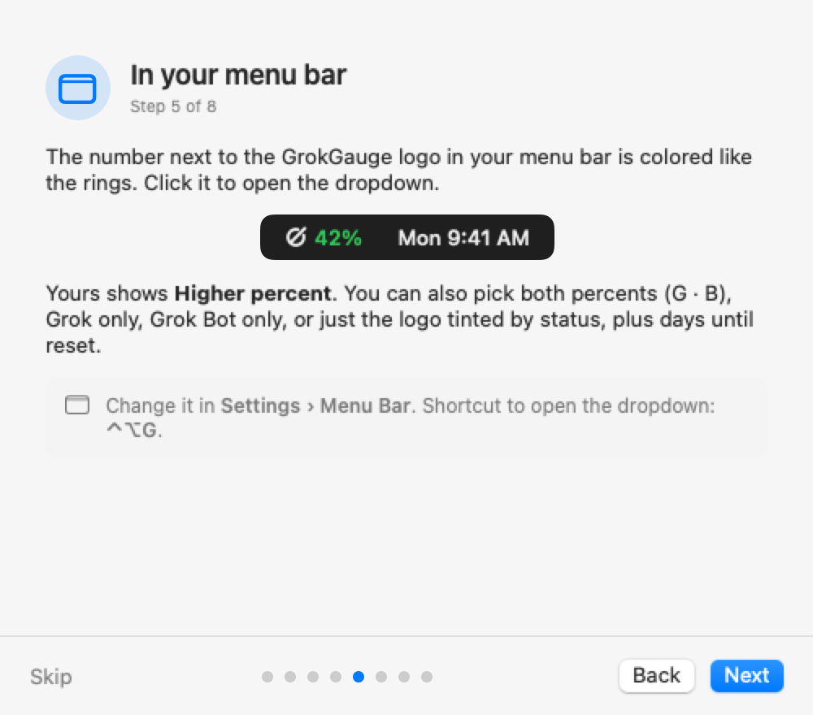 | 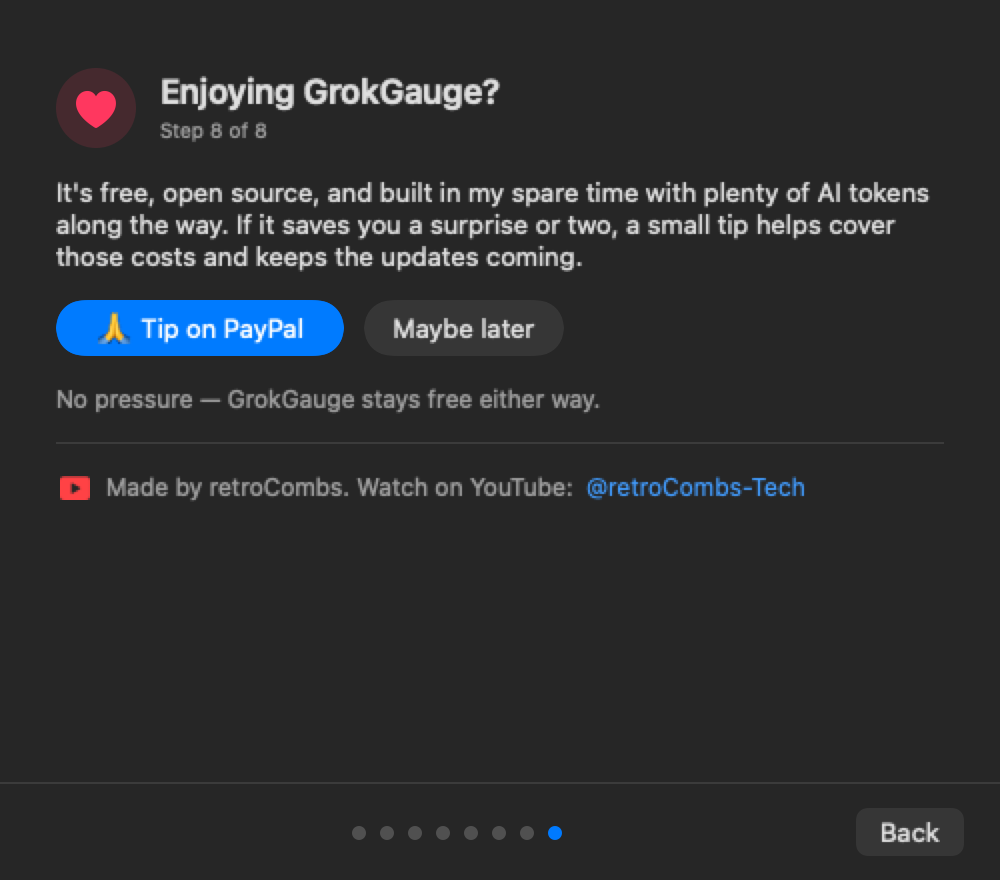 |

## Settings

Open Settings with the gear button in the dropdown or **⌘,** while the dropdown is open.
Everything applies immediately.

| | |
|---|---|
| 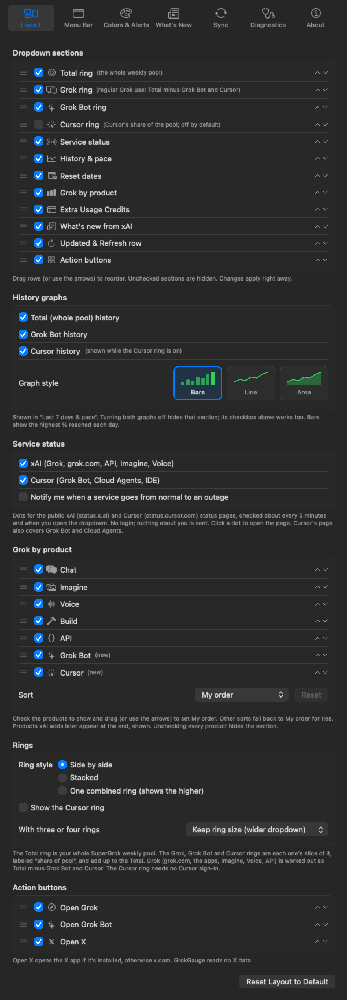 | 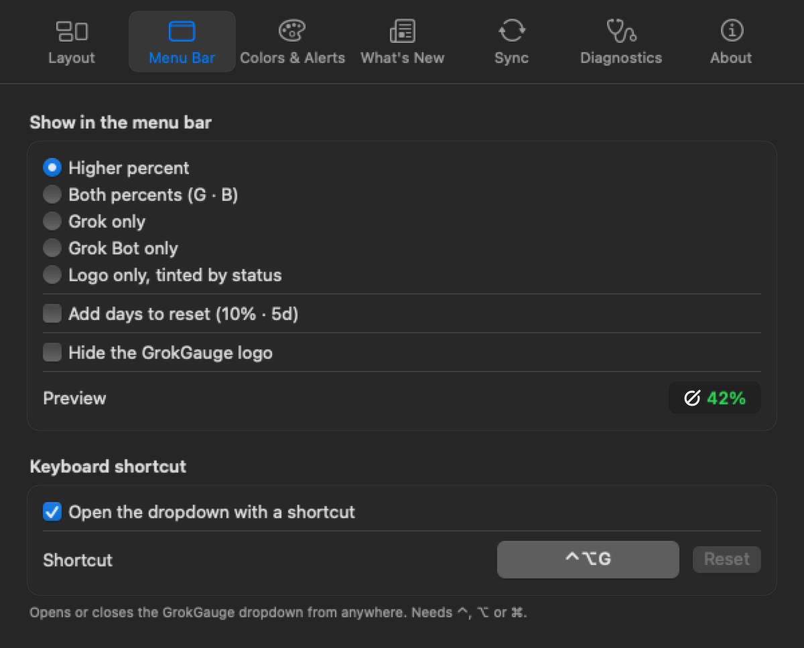 |
| 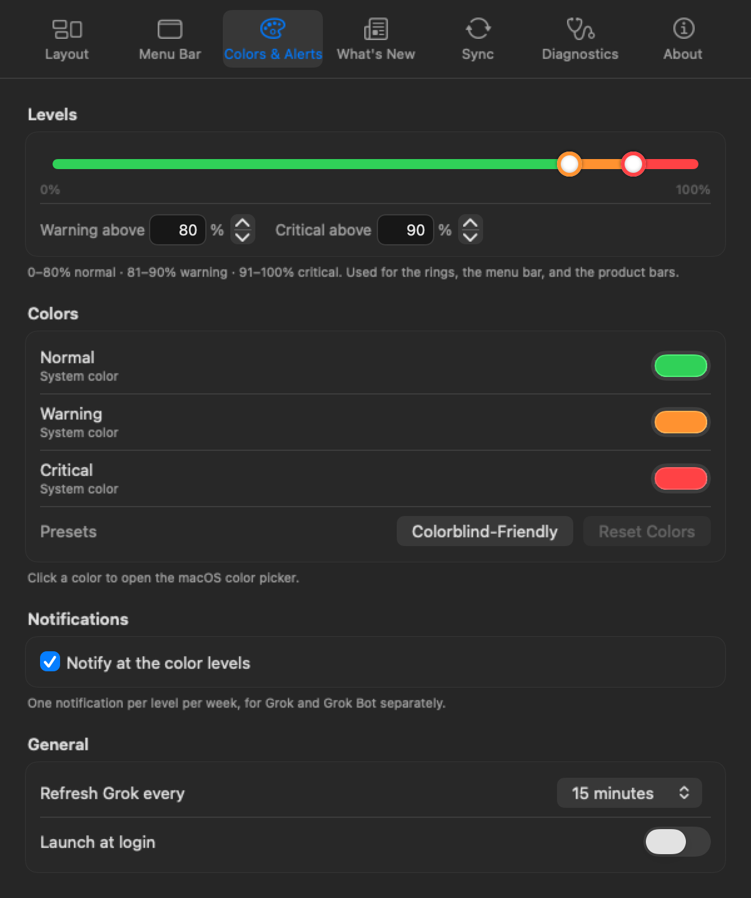 | 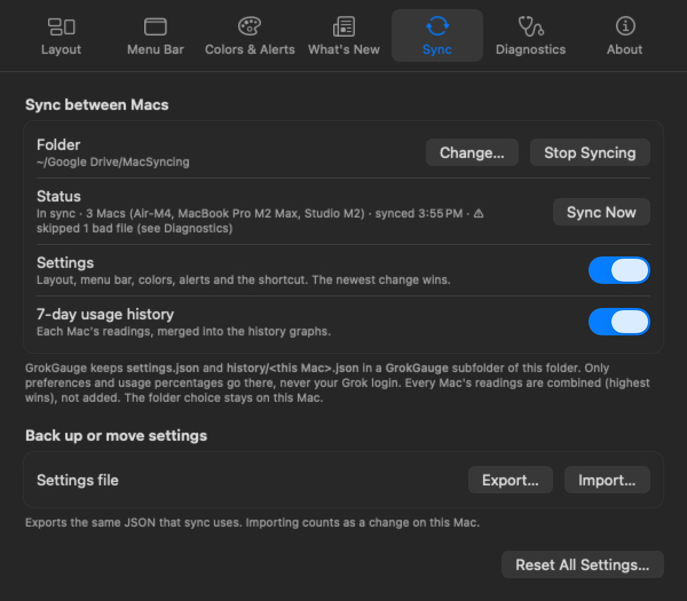 |
| 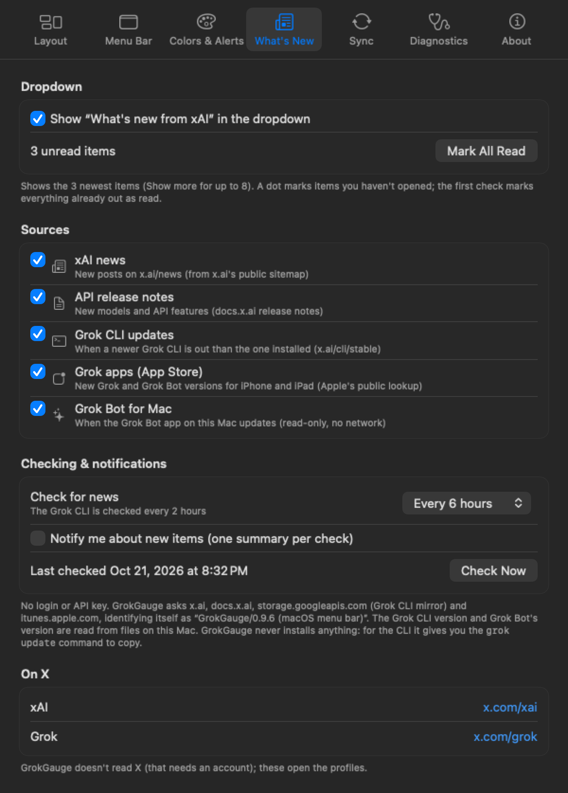 | 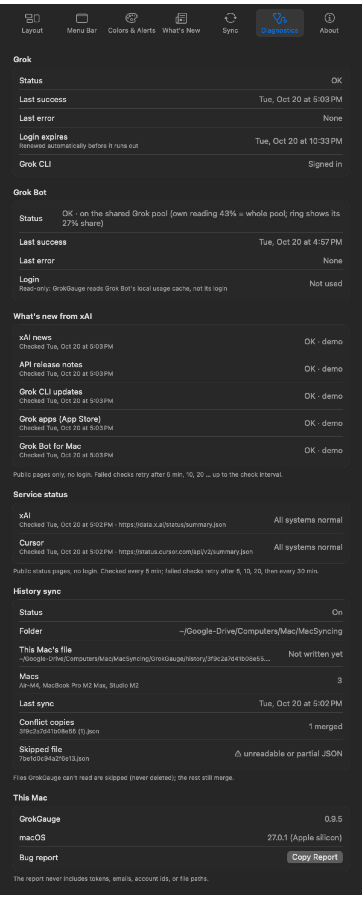 |
| 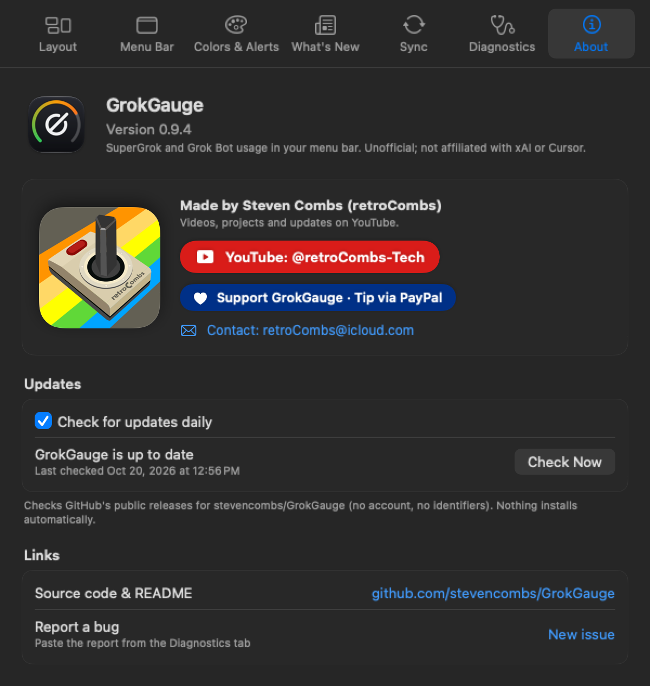 | |

- **Layout.** Check or uncheck each dropdown section (Total ring, Grok ring, Grok Bot ring, Cursor ring, service status, 7-day history,
  reset dates, Grok by product, Extra Usage Credits, the Updated/Refresh row, action buttons) and drag
  rows to reorder them (the arrow buttons and VoiceOver actions work too). Under **History graphs**,
  choose whether the Total, Grok Bot and Cursor graphs appear (the Cursor graph only while the Cursor ring is
  on; turning them all off hides the section) and pick the
  **Graph style**: Bars (one bar per day, the default), Line, or Area. Under **Grok by product**, check
  which products appear (Chat, Imagine, Voice, Build, API, plus any product xAI adds later, which shows up
  at the end), drag them into your order, and pick a **Sort**: My order, Highest usage first (ties keep
  your order) or Alphabetical; unchecking them all hides the section. Under **Service status**, choose
  the **xAI** and **Cursor** dots (both on by default; turning both off hides the row) and the optional
  outage notification. Under **Rings**, pick the ring style, switch the Cursor ring on, and choose
  **With three or four rings**: keep ring size or shrink to fit. Then
  choose which action buttons appear and in what order. **Reset Layout to Default** undoes it all.
- **Menu Bar.** Higher percent, both (`G · B`), Grok only, Grok Bot only, or the logo alone tinted
  green/orange/red. Optional days-to-reset suffix and a hide-the-logo switch, with a live preview.
  Set or turn off the global shortcut here; if another app already owns a combination, GrokGauge says so.
- **Colors & Alerts.** Drag the two handles of the level slider (or type the numbers) to set where
  *warning* and *critical* start; the handles can't cross and stay at least 1% apart. Pick each level's
  color with the macOS color picker; GrokGauge warns you if two colors are hard to tell apart
  (CIEDE2000 ΔE below 12) and offers a colorblind-friendly preset (Okabe–Ito blue/orange/vermilion).
  Colors apply to the rings, the menu bar percent and the product bars. Notifications follow the color
  levels unless you uncheck **Notify at the color levels** and set separate ones. Also: refresh interval
  (5, 15, 30 or 60 minutes) and **Launch at login**.
- **What's New.** Show or hide the “What's new from xAI” section, choose its sources (xAI news, API
  release notes, Grok CLI updates, Grok apps on the App Store, Grok Bot for Mac), how often to check
  (every 6, 12 or 24 hours; the Grok CLI every 2 hours), whether to get one summary notification per check
  (off by default), **Check Now** and **Mark All Read**. The first check marks everything already out as
  read, so you only see a dot for what's new after that. Read marks stay on this Mac; the choices sync.
- **Sync.** One folder, one status line, one **Sync Now**, and a switch each for **Settings** and
  **7-day usage history** (the one-folder layout is new in 0.9.5). See
  [Using it on several Macs](#using-it-on-several-macs). **Export…** and **Import…** save and load the
  same JSON file.
- **Diagnostics.** For Grok and Grok Bot: status, last success, last error (including the server's own
  error message for HTTP errors other than 401/403, with anything token-, email- or id-like removed), and (for Grok) when the
  login expires, plus the app and macOS versions. **Copy Report** puts a plain-text summary on the
  clipboard for bug reports; it never includes tokens, emails, account ids, or file paths. Each
  What's new source shows its status, last check and last error.
- **About.** Version, who made it (with the [@retroCombs-Tech](https://www.youtube.com/@retroCombs-Tech)
  YouTube channel, a contact address and a **Support GrokGauge · Tip via PayPal** button), links, and **Check for updates daily** (on by default). When a newer release is
  out, the dropdown footer shows **Update available** with a link to the release and the
  `brew upgrade --cask grokgauge` command. GrokGauge never installs anything by itself.

## Using it on several Macs

Install GrokGauge and run `grok login` on each Mac (logins are never synced). Then open
*Settings › Sync* on each Mac and choose a folder your Macs already sync, such as a Google Drive, Insync,
Dropbox or iCloud Drive folder.

Since 0.9.5 the Sync tab is one section, **Sync between Macs**:

<p align="center">
  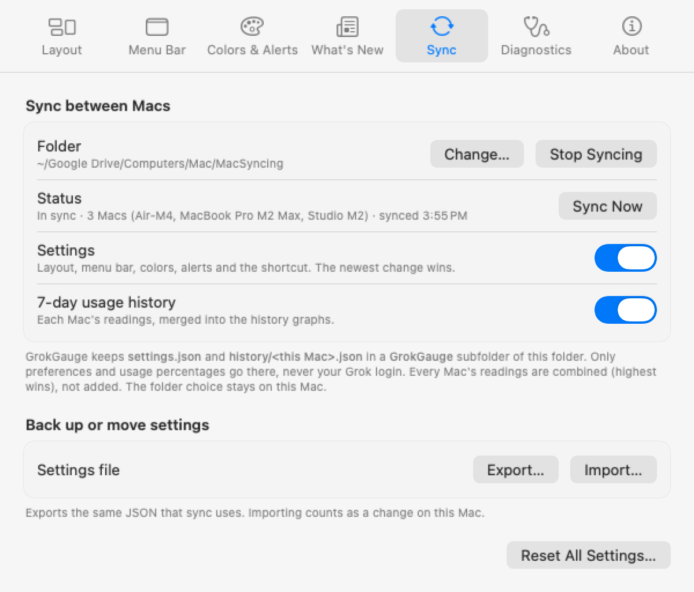
</p>

- **One folder** (Change… / Stop Syncing) for everything. GrokGauge keeps `settings.json` and
  `history/<this Mac>.json` in a `GrokGauge` subfolder there.
- **One status line** for both, for example "In sync · 3 Macs (Air-M4, MacBook Pro, Studio) · synced 11:38 PM",
  and one **Sync Now**.
- **Two switches**, both on by default: **Settings** and **7-day usage history**.
- If you haven't picked a folder, GrokGauge looks for a `MacSyncing` folder in your cloud-drive folders and
  uses it. **Stop Syncing** is remembered, so the folder won't be picked up again by itself.
- **All your Macs end up in the same folder.** GrokGauge checks nearby folders for GrokGauge data (it only
  reads them). If no other Mac uses this Mac's folder but your other Macs use another one, it moves there by
  itself, for example from `MacSyncing/xAI` to `MacSyncing`. If other Macs share this folder too, it offers
  **Switch** instead of moving. Older folders that still hold history are read (never written), so Macs
  still on 0.9.4 or earlier keep showing up. *Settings › Diagnostics › History sync* lists them.

How each part syncs:

- **Settings:** layout, menu bar, levels, colors, notification levels, refresh interval, shortcut, and the
  update-check switch. Never your Grok login or tokens. GrokGauge watches the file, notices in-place
  edits and sync clients that replace it, and checks every 30 seconds as a fallback. The newest change
  wins (by the time it was made), including changes made while a Mac was offline.
- **History:** each Mac writes only its own file, `GrokGauge/history/<machine-id>.json`, and merges
  everyone's. Usage is account-wide, so matching readings are combined by taking the highest, never added.
  Conflict copies from Insync or Drive are merged; damaged files are skipped and shown in
  *Settings › Diagnostics*, along with the folder, the number of Macs, the last sync and any write error.
- The folder choice itself stays on each Mac. With no folder, settings and history stay on the Mac.

0.9.4 and earlier had separate folder pickers for settings and for usage history; 0.9.5 moves them to the one folder.

## Privacy

### Grok

- Your Grok tokens **never leave your Mac** except to two xAI hosts, over HTTPS:
  - the access token goes to xAI's usage endpoint (`cli-chat-proxy.grok.com`), and
  - the refresh token goes to xAI's sign-in server (`auth.x.ai`), only when the login needs renewing.
  They go nowhere else. GrokGauge refuses to send them to any other host.
- **GrokGauge writes to `~/.grok/auth.json`.** When it renews your login it saves the new tokens
  back into that file so the Grok CLI keeps working with them. It changes only the token fields
  of that one login (`key`, `refresh_token`, `expires_at`, `create_time`), keeps every other field
  and the file's owner-only (`0600`) permissions, and writes atomically while holding the same
  `auth.json.lock` the CLI uses, so the two never renew at the same moment.
- Tokens are never logged, printed, or copied anywhere else.
- Requests use an ephemeral session (no cookies, no cache) and refuse redirects, so tokens
  can't be forwarded to another host.

### Grok Bot

- GrokGauge **makes no network requests for Grok Bot** and uses **no Grok Bot token, password, or
  Keychain item**. It never sends Grok Bot data anywhere.
- It only **reads** two small files that Grok Bot itself writes, both inside
  `~/Library/Application Support/Grok Bot/sand-client-persistence/`:
  - the signed-in account marker (storage key `sand.client.slice.client-meta.account-slot`), and
  - that account's weekly-usage cache (storage key
    `sand.client.slice.account.<account>.weekly-usage.cache`): the percent used, the next reset
    time, and when Grok Bot last checked.

  Grok Bot names each file after its storage key (base32-encoded, plus `.blob`). Neither file
  contains a credential.
- GrokGauge never writes to, renames, or deletes anything in Grok Bot's folder. It doesn't touch
  Grok Bot's login or its encrypted secrets (`sand-secrets.json` and the "Grok Bot Safe Storage"
  Keychain item), and it never talks to Grok Bot's servers.

### Settings, history, and updates

- **Settings sync** writes only `GrokGauge/settings.json` in the folder you choose, containing
  preferences only (no tokens, emails, ids, usage, or history). If you haven't picked a
  folder, a `MacSyncing` folder found in your cloud-drive folders is used (since 0.9.5; turn it off with
  **Stop Syncing**). In 0.9.4 and earlier nothing synced until you picked a folder.
- **History** for the graphs is kept in `~/Library/Application Support/GrokGauge/history.json`:
  timestamps and percents only, pruned after 8 days. With history sync on and a sync folder available, a
  copy goes to `GrokGauge/history/<machine-id>.json` in that folder, containing only those percents and
  timestamps, an anonymous per-Mac id (a hash, not the hardware UUID itself) and the Mac's name. Never
  tokens, emails, account ids, or anything from `~/.grok`. It's never sent anywhere else.
- **Update check** (optional, daily) asks GitHub's public API for the latest
  [stevencombs/GrokGauge](https://github.com/stevencombs/GrokGauge/releases) release. It's unauthenticated
  and sends no identifiers besides a `GrokGauge/<version>` User-Agent.
- **Open X** just opens the X app or x.com. GrokGauge reads no X data.
- **Support GrokGauge…** (dropdown footer, app menu, Settings › About) just opens
  [paypal.me/stevencombs](https://paypal.me/stevencombs) in your browser.

### What's new from xAI

Public pages only: no login, no API key, no cookies, nothing about you. Each request identifies itself
as `GrokGauge/<version> (macOS menu bar)`. Hosts contacted, only for the sources you leave on:

| Source | Host and URL | How often |
|---|---|---|
| xAI news | `x.ai/sitemap.xml`, then `x.ai/news/<post>` for titles of new posts (at most 5 per check) | every 6 h (or 12/24) |
| API release notes | `docs.x.ai/developers/release-notes.md` | every 6 h (or 12/24) |
| Grok CLI updates | `x.ai/cli/stable` (fallback `storage.googleapis.com/grok-build-public-artifacts/cli/stable`) | every 2 h |
| Grok apps | `itunes.apple.com/lookup` (Apple's public App Store lookup) | every 6 h (or 12/24) |
| Grok Bot for Mac | no network: reads `/Applications/Grok Bot.app/Contents/Info.plist` | every 15 min |

- The first check runs about a minute after launch. Requests time out after 15 s; failures back off
  (5 min, 10, 20 … up to the interval). Conditional requests (`If-None-Match`/`If-Modified-Since`)
  are used where the server supports them.
- To compare Grok CLI versions GrokGauge **reads** `~/.grok/bin/grok` (the symlink's target name), else
  Homebrew's `grok-build` copy (where `/opt/homebrew/bin/grok` or `/usr/local/bin/grok` points, inside
  `Caskroom/grok-build/<version>/`), else `~/.grok/version.json`. It never runs the CLI, `grok update` or
  `brew`; it shows the right update command for you to copy.
- Items and read marks stay in `~/Library/Application Support/GrokGauge/whatsnew.json` (never synced).
- X isn't read (that needs an account); the section links to the @xai and @grok profiles instead.

### Service status

Public status pages only: no login, no API key, no cookies, nothing about you. Requests identify themselves
as `GrokGauge/<version> (macOS menu bar)`. Only the sources you leave on are checked, about every 5 minutes
and when you open the dropdown (at most every 30 s); failures back off (5 min, 10, 20, then every 30).

| Dot | URL | Fallback |
|---|---|---|
| xAI | `data.x.ai/status/summary.json` (the data behind status.x.ai) | `status.x.ai/feed.xml` (RSS of incidents) if the summary fails or changes shape |
| Cursor | `status.cursor.com/api/v2/summary.json` (Statuspage's public API) | none: the dot turns gray |

Nothing is stored on disk; Settings › Diagnostics › **Service status** shows each source's last result,
error and the URL used.

### Everything

- No analytics, no telemetry. Besides xAI, GitHub (update check), the What's new hosts and the two
  status pages above, GrokGauge talks to no servers.

## How it works (and the fine print)

GrokGauge calls the same **unofficial** billing endpoint the Grok CLI uses for its `/usage` view:

```
GET https://cli-chat-proxy.grok.com/v1/billing?format=credits
Authorization: Bearer <token from ~/.grok/auth.json>
```

and reads `config.creditUsagePercent`, `config.currentPeriod`, `config.productUsage`, and the credit
balances. xAI doesn't document this endpoint and can change it at any time, which could break
GrokGauge until it's updated.

- When xAI omits `creditUsagePercent` but the rest of the reply looks normal (it does this right
  after a reset, since zero values are dropped), GrokGauge shows 0% and labels the ring
  **"Inferred (none reported)"**.
- If the reply is JSON but no longer has the expected shape (no `config`, no current period), GrokGauge
  shows **"xAI changed something"** and a dash instead of a misleading 0%, and keeps retrying.
- Each refresh opens its own connection. A 400, 408, 421 or 5xx reply, or a dropped connection, is retried
  once right away on a new connection (a stuck server instance can't keep GrokGauge on an error), and then
  with backoff like network errors.
- Network errors are retried with exponential backoff (30 s, 1 min, 2 min, … up to 15 min). After your
  Mac wakes or switches networks, GrokGauge waits a few seconds before refreshing and retries quietly
  for a short grace period, so you don't see "You're offline" flash on wake.

### Grok Bot

The Grok Bot app checks your weekly usage with its own server and caches the result on disk (see
[Privacy](#grok-bot)). GrokGauge re-reads that cache every 2 minutes, whenever you open the
dropdown, and on every Grok refresh. That means:

- The Grok Bot number is **as fresh as Grok Bot's last check**. The ring shows "as of 4:28 PM" so
  you know how old it is (with the date, "as of Oct 7, 5:38 PM", when the reading is from an earlier day). Grok Bot updates the cache on its own schedule, and only while it's
  running. Opening Grok Bot's *Usage & Billing* screen is a quick way to get a fresh number.
- If the cached reading has expired (Grok Bot keeps it for about a day) or its week has already
  reset, the ring goes gray and says **"Open Grok Bot to update."** If Grok Bot is signed out or
  hasn't checked yet, it says **"Open Grok Bot to reconnect."** Only the Grok Bot ring changes;
  Grok keeps working.
- Percentages are rounded the same way Grok Bot rounds them (anything between 0 and 1% shows as 1%).
- Grok Bot's cache format is internal to Grok Bot and may change in a future version. If it does,
  the ring says "Couldn't read usage" until GrokGauge is updated.

### Staying signed in

Grok CLI access tokens last a few hours. GrokGauge renews the login when the access token is
within an hour of expiring, or right away if the usage endpoint rejects it, then retries the usage
request once. Renewal uses the same OpenID Connect refresh flow as the official Grok CLI
([xai-org/grok-build](https://github.com/xai-org/grok-build), `xai-grok-login`):

1. Take the CLI's lock (`~/.grok/auth.json.lock`) and re-read `auth.json`. If the CLI already
   renewed the token, use that one and stop.
2. Look up the token endpoint from `https://auth.x.ai/.well-known/openid-configuration`.
3. `POST https://auth.x.ai/oauth2/token` with `grant_type=refresh_token`, the stored
   `refresh_token`, and the stored `oidc_client_id` (plus `principal_type`/`principal_id` when present).
4. Save the new access token, the rotated refresh token (if xAI sent one), and the new expiry back
   into `auth.json`, then release the lock.

If xAI rejects the refresh token, GrokGauge stops and asks you to run `grok login`. If auth.x.ai
is just unreachable, it keeps using the current token while it's still valid and tries again later.

### Debug flags

Want the raw numbers? Run the app binary with a debug flag. None of them print your tokens:

```sh
/Applications/GrokGauge.app/Contents/MacOS/GrokGauge --print-usage   # Grok + Grok Bot; or --json
/Applications/GrokGauge.app/Contents/MacOS/GrokGauge --refresh-now   # renew the login now; prints expiry times
/Applications/GrokGauge.app/Contents/MacOS/GrokGauge --print-status  # check the xAI and Cursor status pages once
/Applications/GrokGauge.app/Contents/MacOS/GrokGauge --render-preview ~/Desktop/gg --demo   # dropdown, menu bar and Settings PNGs
/Applications/GrokGauge.app/Contents/MacOS/GrokGauge --render-tour ~/Desktop/gg --demo      # welcome tour cards + Sync tab
```

## Build from source

You only need the Xcode **Command Line Tools** (`xcode-select --install`); the full Xcode app is optional.

```sh
git clone https://github.com/stevencombs/GrokGauge.git
cd GrokGauge
./scripts/test.sh            # unit tests
./scripts/build-app.sh       # -> dist/GrokGauge.app and dist/GrokGauge-<version>.zip
open dist/GrokGauge.app
```

`build-app.sh` compiles a universal (arm64 + x86_64) release binary with Swift Package Manager,
assembles the `.app` bundle, ad-hoc signs it, and zips it. Set `ARCHS=arm64` for an Apple
silicon-only build, or `CODESIGN_IDENTITY="Developer ID Application: …"` to sign with your own
certificate.

### Releasing

1. Bump `VERSION` (and `version` in `Casks/grokgauge.rb`), commit, then tag: `git tag -a v1.2.3 -m "GrokGauge 1.2.3" && git push origin v1.2.3`.
2. The **Release** GitHub Action runs the tests, builds the universal app, and attaches
   `GrokGauge-<version>.zip` (and its `.sha256`) to a GitHub release.
3. In [stevencombs/homebrew-tap](https://github.com/stevencombs/homebrew-tap), update `version`
   and `sha256` in `Casks/grokgauge.rb` (use the sha256 from the release; until then this repo's copy
   carries a placeholder), then copy that file to `Casks/grokgauge.rb` here so the two stay in sync. Check it with `brew audit --cask --strict --online stevencombs/tap/grokgauge`.

### Project layout

```
Sources/GrokGaugeCore/   auth.json + token renewal, the billing request, the Grok Bot cache reader,
                         settings model + sync, colors, pace, history, update check (Foundation only)
Sources/GrokGauge/       menu bar app (AppKit + SwiftUI), Settings window, notifications, shortcut, debug CLI
Tests/                   swift-testing unit tests
scripts/                 build-app.sh, test.sh, assets/make-icon.py
Resources/               Info.plist template, AppIcon.icns
Casks/grokgauge.rb       Copy of the cask in stevencombs/homebrew-tap
```

See [CONTRIBUTING.md](CONTRIBUTING.md) for how to contribute and [CHANGELOG.md](CHANGELOG.md) for what changed.
What's next: [ROADMAP.md](ROADMAP.md).

## Credits and contact

<p>
  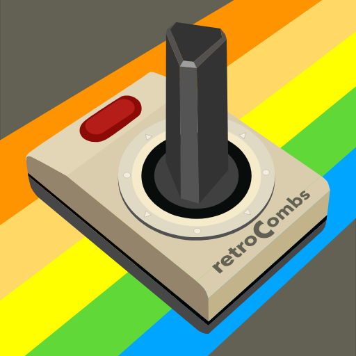
</p>

Created by **Steven Combs** (**retroCombs**) and built together with **Grok Bot**, Steven's AI assistant,
which wrote the code, tests, and docs to his spec.

- **YouTube:** [@retroCombs-Tech](https://www.youtube.com/@retroCombs-Tech)
- **Contact:** [retroCombs@icloud.com](mailto:retroCombs@icloud.com)
- **Bugs and feature requests:** [GitHub issues](https://github.com/stevencombs/GrokGauge/issues/new/choose)
- **Support the project:** if GrokGauge saves you a surprise at the weekly limit, you can
  [tip via PayPal](https://paypal.me/stevencombs). Thank you!

The same links are in GrokGauge under **Settings › About**.
<br clear="left">

### More apps from retroCombs

- **[ClipGauge](https://stevencombs.github.io/ClipGauge/)**: local AI that renames and sorts your video and photo clips in place, with transcripts saved next to them. ([GitHub](https://github.com/stevencombs/ClipGauge))


Endpoint details were cross-checked against the open-source
[pi-grok-usage](https://github.com/apoapostolov/pi-grok-usage),
[CodexBar](https://github.com/steipete/CodexBar), and
[OmniRoute](https://github.com/diegosouzapw/OmniRoute) projects. The GrokGauge glyph is an original
drawing and isn't xAI's logo.

## License

[MIT](LICENSE) © 2026 Steven Combs (retroCombs)
